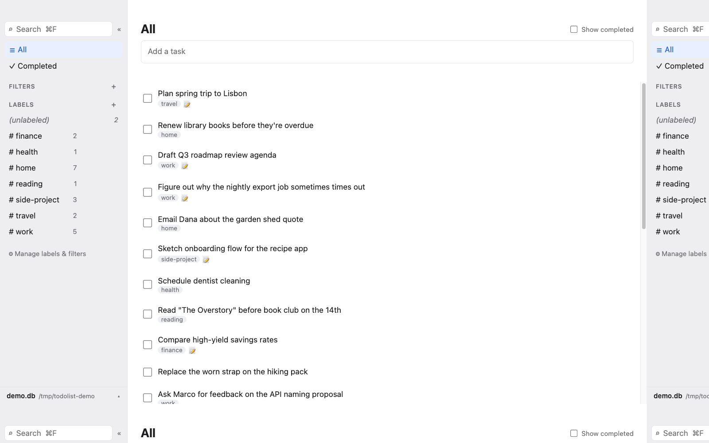
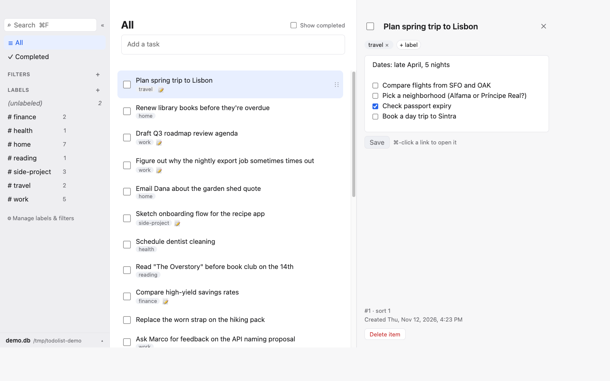
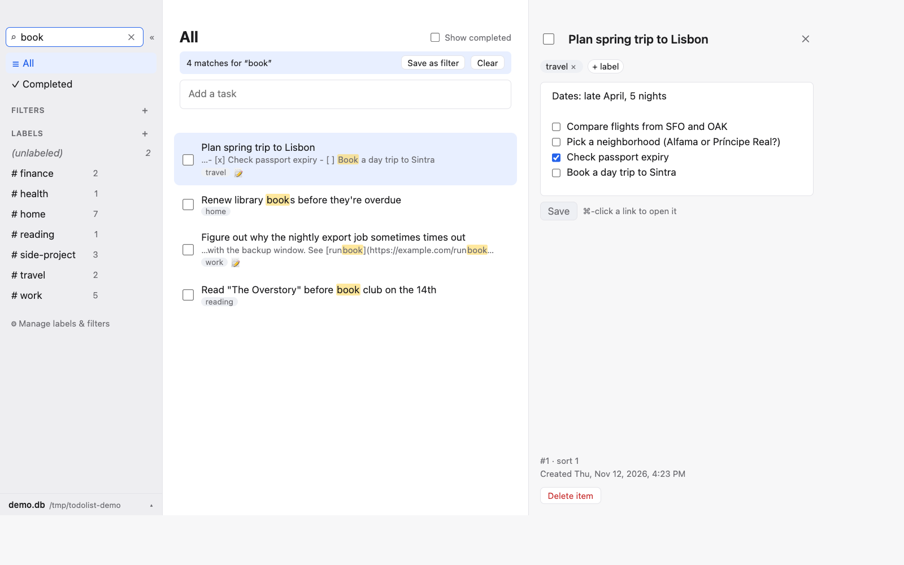
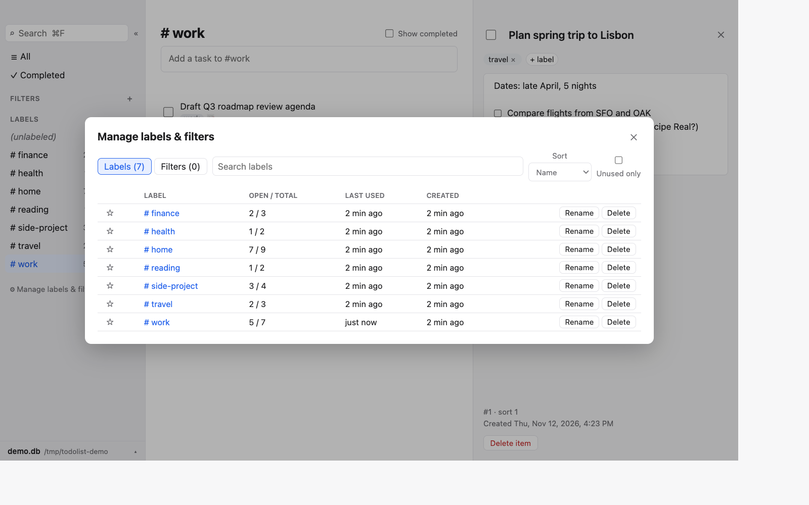
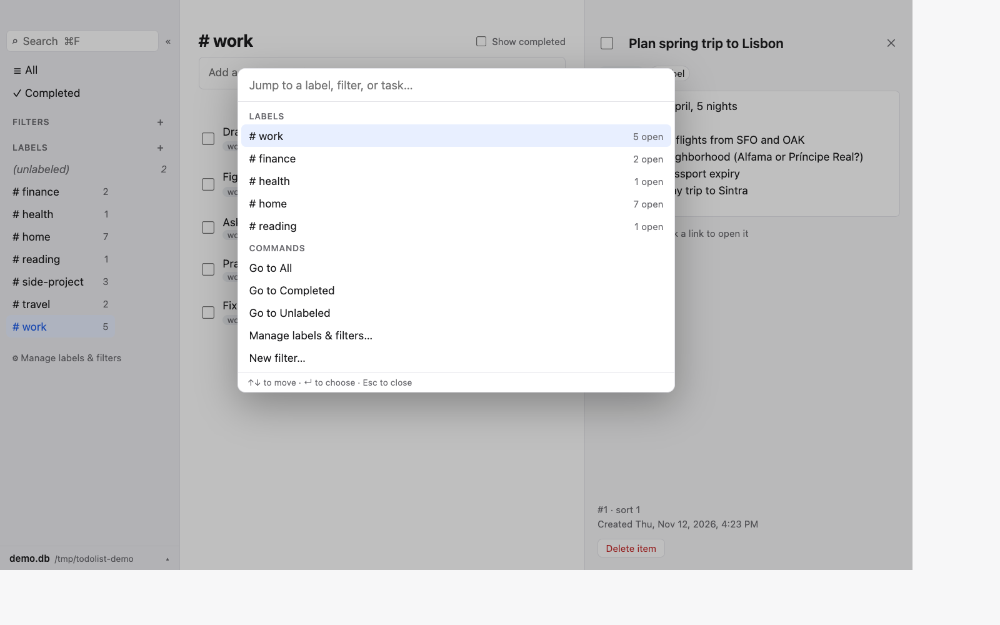

+++
title = "Todo List Design"
date = 2026-11-13
+++

> NOTE: 2026-11-13: I vibe coded this and also had AI write the blog post, and it shows. I've been using the TODO list though, so I hope the ideas are valuable.

# A todo list that both you and your AI agent can use

Most todo apps are built for one kind of user: a person clicking in a window. This one, `todolist`, is built for two. There is a desktop app for the human side, and a `todo` command-line tool that an AI agent can drive just as easily. Both read and write the same SQLite database, so a task an agent adds shows up in the app within a moment, and a task you check off in the app is checked off for the agent too.

This post walks through what the app does, how it stays usable as the list grows, and the CLI an agent would use.

## What it does

- **Items** are tasks with a title, optional Markdown notes, labels, and a manual sort order you can change by dragging.
- **Labels** are tags. An item can have several, and there are no folders to pick between.
- **Filters** are saved searches. You can write one as an expression, or turn any search into a filter with one click.
- **Quick add** takes a multi-line entry. The first line is the title, `#words` on the next line become labels, and anything after that becomes notes.
- **Notes** support Markdown with a live preview and checkboxes you can tick in place.
- **Search** matches title and notes at once, highlights the hits, and shows a snippet for each result.
- **Backups** are taken from the live database with `todo db backup`, so you can copy a consistent snapshot while the app is running.
- **Several databases.** You can keep a work list and a personal list separate and switch between them from the bottom of the sidebar.

Here is the main view, with a sidebar of labels and a few items:



Opening an item shows its notes and checklist in a side pane:



Search runs across titles and notes. Here "book" matches four items, including one that only has the word in its notes:



## Keeping it usable as the list grows

A list that works at 20 items starts to fail at 200. The app's answer is to keep the default view small and let the organizing tools do the rest. The ideas below are borrowed from Gmail, which has spent years solving the same problem for email. Thank you to the Gmail team for the patterns.

### Items: hide what's done, keep the rest in order

- Completed items are hidden by default. A "Show completed" toggle brings them back, and a Completed view lists them on their own.
- Manual order is the default and you can drag to reorder. Keyboard users can use ⌥↑ and ⌥↓.
- Search covers titles and notes, so you rarely need to remember which list something lives in.

### Labels instead of folders

Gmail's labels changed how people think about email: a message can belong to several places at once, and you don't have to decide where it "lives." The same rule applies here. An item such as "Schedule dentist cleaning" can carry `health` and `home` without a copy in each.

As the number of labels grows, the sidebar stays short:

- **Pinned** labels always appear at the top.
- Below them, the sidebar shows the labels you used most recently and the ones you created most recently.
- Anything else sits behind **Manage labels & filters**, a table with open and total counts, last-used times, and an "Unused only" toggle for cleanup.

The table view is the same idea as Gmail's "Manage labels" page.



### Filters: saved searches

Gmail lets you turn a search into a filter. Here, a search that matches several items shows a **Save as filter** button. Filters can also be written as expressions, which is useful for rules like "open items with `work` and no notes from the last week."

From the CLI, the same filter looks like this:

```sh
todo filter create --name "Work, no notes" \
  --expr '"work" in labels && body == "" && !completed'
```

### Jumping around

⌘K opens a quick switcher for labels and filters. Keyboard-first navigation is one more Gmail idea that scales well: you type a few letters and land where you need to be, without scrolling a sidebar.



## The CLI: for people who script and for agents

Everything the app can do is available from the `todo` command. Output can be human-readable or `--format json`, and each command has a `--help`.

```sh
# Capture a task, creating the label if it's new
todo item create --title "Renew passport" \
  --label travel --create-missing-labels true

# Find open work items that mention a term
todo item list --label work --search "migration"

# Complete an item by id
todo item complete --id 12

# See the structure of the list
todo label list --format json
```

The full command set, with an example of each. Replace item and filter IDs with those returned by `create` or `list`; these rows are examples, not a script to run in order.

| Command | Example | What it does |
|---|---|---|
| `item create` | `todo item create --title "Book a night train to Lisbon" --label travel --create-missing-labels true` | Create a task and, if needed, its label. |
| `item list` | `todo item list --label travel --search "Lisbon" --format json` | Find open tasks matching a label and search. |
| `item show` | `todo item show --id 12` | Show a task's details and notes. |
| `item update` | `todo item update --id 12 --body "Compare sleeper cabins before booking" --add-label travel` | Edit notes and add an existing label. |
| `item complete` | `todo item complete --id 12 --completed-time 2026-11-12T17:00:00Z` | Record when a task was actually completed. |
| `item uncomplete` | `todo item uncomplete --id 12` | Reopen a completed task. |
| `item reorder` | `todo item reorder --id 18 --id 12` | Put these tasks, in this order, into the positions they currently occupy; other tasks stay put. |
| `item delete` | `todo item delete --id 12 --confirm false` | Permanently delete a task without prompting. |
| `label create` | `todo label create --name travel` | Create a label before applying it to tasks. |
| `label list` | `todo label list --format json` | List labels, counts, and usage metadata. |
| `label show` | `todo label show --name travel --include-completed true` | Show a label and its tasks, including completed ones. |
| `label rename` | `todo label rename --name travel --new-name adventures` | Rename a label, or merge it into an existing label. |
| `label delete` | `todo label delete --name travel --confirm false` | Remove the label from all tasks, without deleting the tasks. |
| `filter create` | `todo filter create --name "Lisbon plans" --expr '"travel" in labels && search("Lisbon") && !completed'` | Save a matching rule as a filter. |
| `filter list` | `todo filter list --format json` | List saved filters and their IDs. |
| `filter show` | `todo filter show --id 3` | Show a filter and the open tasks it matches. |
| `filter update` | `todo filter update --id 3 --name "All open travel" --expr '"travel" in labels && !completed'` | Change a filter's name and matching rule. |
| `filter delete` | `todo filter delete --id 3 --confirm false` | Delete a saved filter, leaving its matching tasks intact. |
| `db backup` | `todo db backup --destination-dir ~/.config/todolist-backups --limit 10` | Snapshot the live database and retain up to 10 backups. |
| `repl` | `todo repl` | Start an interactive command session. |
| `version` | `todo version` | Print the CLI version. |

Label renames and deletions do not rewrite saved filter expressions. The CLI warns about affected filters; use `todo filter update` to adjust them.

Two details matter for agents. First, a label must exist before it's used, unless the agent passes `--create-missing-labels true`, which stops near-duplicates like `grocery` and `groceries` from piling up. Second, the database path can come from `--db-path` or the `TODOLIST_DB_PATH` environment variable, so an agent can point at a test database without touching the real one.

## What's next

The app is built around a simple idea: the list should stay small enough to read, whether you or an agent is reading it. Labels, saved filters, and a quick switcher carry most of the load now. Gmail showed these ideas can hold up at very large scale, and this app borrows them in the hope that they hold up for a list of a few hundred items too.
